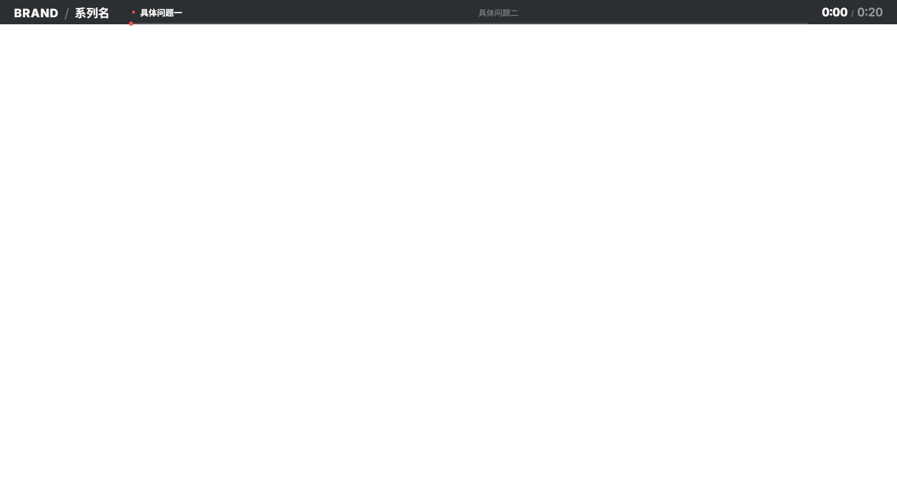

# liwenrui-chapter-progress-bar

给成片加顶部章节进度条。喂 SRT 字幕，AI 通读全文理解观众路径后分段、用陈述句命名，输出透明 ProRes 4444 素材（拖进剪映）或直接烧进 mp4。



## 它解决什么

手动做进度条是这样的：调颜色、画刻度、对时间轴、写章节标题、调字号……**每个视频都要重来一遍**。

这个 skill 把这件事变成一次性的：给 SRT，出成品。

## 核心不是"能生成进度条"

市面上的进度条工具都能生成。这个的差别在三个地方：

### 1. 先理解，再切段

**进度条是观众的观看导航，不是作者的文稿目录。**

切段前必须读完全文、答三个问题（片子回答观众什么问题 / 观看路径是什么 / 每段观众的疑问是什么），然后按观看路径切，不按话题或工序切。

### 2. 标题是陈述句，不是台词摘抄

| ❌ 台词摘抄 | ❌ 作者侧概括 | ✅ 观众的问题 / 陈述句 |
|---|---|---|
| 七万一千星 | 认识素材库 | 凭什么七万星 |
| 不是死图片 | 拆解与入库 | 每一页都能改 |
| 论证先行 | 制作新样式 | 它先想再画 |

真实案例：一条 34 秒片子的初版标题四个里三个不合格，改完才成——判断标准写在 `SKILL.md` 里。

### 3. 三道自动拦截

| 拦截 | 拦什么 |
|---|---|
| **SRT 原话核对** | 字幕改了/剪了，秒数整体偏移且不报错——脚本逐字核对首尾句，报偏移多少秒 |
| **段长校验** | 段短于 4s，标题来不及读 |
| **渲染后 QA** | 编码/尺寸/alpha/帧数/时长，出坏文件直接失败 |

## 安装

```bash
git clone https://github.com/liwenrui2333/liwenrui-chapter-progress-bar.git \
  ~/.claude/skills/liwenrui-chapter-progress-bar
cd ~/.claude/skills/liwenrui-chapter-progress-bar
npm install
```

依赖：Node.js 18+、ffmpeg / ffprobe。

首次渲染 Remotion 会自动下载 chrome-headless-shell（约 150MB）。已有可设环境变量跳过：

```bash
export REMOTION_BROWSER=/path/to/chrome-headless-shell
```

## 快速开始

```bash
# 1. 看字幕全文（AI 读这个来决定分段）
node scripts/srt-to-transcript.mjs example.srt

# 2. 写 chapters.json（照 chapters.example.json 改）

# 3. 校验
node scripts/render-chapter-bar.mjs chapters.example.json --dry-run

# 4. 出透明素材（给剪映）
node scripts/render-chapter-bar.mjs chapters.example.json

# 5. 或者直接烧进成片
node scripts/render-chapter-bar.mjs chapters.example.json --overlay input.mp4
```

## 产物

| 文件 | 说明 |
|---|---|
| `<名>-overlay.mov` | ProRes 4444 带 alpha，拖进剪映最上层轨道 |
| `<名>.mp4` | 加了 `--overlay` 时：直接叠好的成片 |
| `<名>-contact-sheet.png` | 所有章节边界的联系表，一眼看完 |

## 配置字段

见 `chapters.example.json` 和 `SKILL.md` 第 5 步。

关键几项：

```json
{
  "duration": 34.319,        // 必填，从 SRT 末条 end 取
  "srt": "example.srt",      // 给了就启用原话核对
  "theme": "dark",           // dark（默认）/ light
  "barHeight": 52,           // 条高
  "width": 1920,             // 无 --overlay 时必填
  "canvasHeight": 1080,
  "chapters": [
    {
      "label": "凭什么七万星",
      "start": 0, "end": 6.566,
      "startText": "据说这是PPT界的天花板",  // 逐字引用
      "endText": "它到底牛在哪？"
    }
  ]
}
```

## 作为 Remotion 组件用

如果你本来就在 Remotion 里做片子，直接把 [`src/ChapterBar.tsx`](src/ChapterBar.tsx) 放进你的 composition，不用走渲染脚本：

```tsx
import { ChapterBar } from './ChapterBar';

<ChapterBar
  brand="BRAND"
  series="系列名"
  chapters={[...]}
  accent="red"
  theme="dark"
  progress
  totalSeconds={169}
/>
```

画布尺寸由你的 composition 决定，组件只负责画。

## 设计约定

- **时间码和填充条严格线性**（`now/total`），不加缓动——它是时钟不是动画
- **开了 `progress` 就强制按时间比例排标签**——否则填充头会飘在两个名字之间的空白上
- **章节多时标签自动省略**（只留圆点），按字宽累计算，不用手调
- **深色主题是默认**——白窗口画面里白条会变成上下两个亮块夹住画面

## License

MIT
